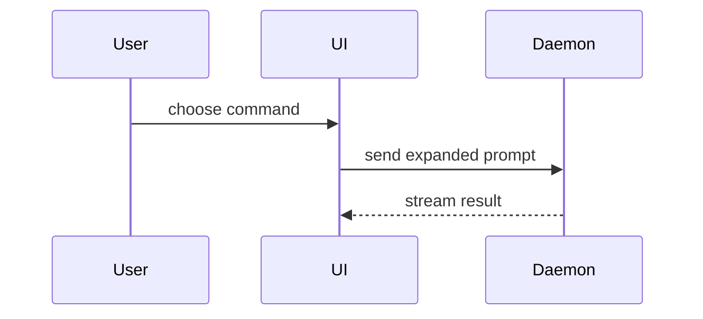

# PR Body

A PR body has one job: let a human understand the change, verify it works, and decide whether merging is risky — **without reading the diff first**. Reviewers read the body before the code; if the body is a wall of prose, the review starts tired.

Skip all preambles. No "This PR implements…", no restating the ticket. Keep prose brief and use the project's domain language (the `GLOSSARY.md` vocabulary, if there is one).

## Workflow

**1. Look at the change before writing.** Read the diff (`git diff <base>...HEAD --stat` then the diff itself) and any linked issue. You are summarising the change, not the ticket that inspired it.

**2. Pick the smallest view that makes the key point clear.** One visual, in the shape of the change — a diagram, a diff sketch, or a tree. If the diff *is* the easiest thing to read, use a diff sketch rather than a picture.

**3. Write the evidence section.** Before/after, concrete and execution-based wherever possible. A real command output beats a description of a command's output.

**4. Make the merge-danger call.** One-way or two-way door, plus a blast radius. Reviewers use this to decide how much scrutiny the change deserves; withholding it slows the review.

**5. Post the body.** `gh pr create --body-file <file>` or `gh pr edit <n> --body-file <file>`. Write the body to a file first — long inline `--body` payloads break on quoting and are unreviewable before they are published.

## Template

```markdown
## Summary

<diagram, diff-sketch, or tree>

## Evidence

- **Before:** <screenshot/output/failing test run>
  **After:** <screenshot/output/passing test run>

## Merge Danger

**Door:** <one-way or two-way>

<optional: description>

**Blast Radius:** <one-word description>

<optional: potential ramifications of merge>
```

## Summary — the visual menu

Pick the smallest view that makes the key point clear. One of these is usually enough; using all of them overwhelms the reader.

- **Logic or an algorithm** — pseudocode:

```text
on(save)
  if content is unchanged
    return cached result
  write new content
  return fresh result
```

- **Runtime control flow** — a call tree:

```text
submitForm
  createSession
    persistPrompt
    launchAgent
  navigateToSession
```

- **UI structure** — a component tree, including the state and module boundaries that matter:

```text
<SessionPage> (apps/example/src/routes/session.tsx)
  useSessionEvents()
  <SessionToolbar>
    <RunSkillButton> (packages/ui)
```

- **File responsibility or a broad refactor** — a shallow file tree:

```text
src/
├── commands/       # parses user actions
├── sessions/       # owns session state
└── transport/      # sends API requests
```

- **Interaction, control flow, or data flow across components** — Mermaid:



- **What changes, when the surrounding shape already exists** — a `diff`, with the shape matched to the topic.

Component change:

```diff
 <SessionPage>
   useSessionEvents()
   <SessionToolbar>
+    <RunSkillButton />
   <SessionTimeline>
+    <SkillResultCard />
```

File-layout change:

```diff
 src/
 ├── commands/
+│   └── expand.ts       # expands the slash command
 ├── sessions/
-└── transport.ts
+└── transport/
+    ├── client.ts
+    └── stream.ts
```

Call-tree change:

```diff
 submitForm
   createSession
     persistPrompt
+    expandMention
     launchAgent
-  navigateToSession
+  navigateToSession
+    subscribeToEvents
```

State or control-flow change:

```diff
 on(save)
-  write content
+  if content is unchanged
+    return cached result
+  write new content
+  invalidate cache
```

- **The whole block**, when most of it is new, when omitted context would hide ownership or order, or when the reader needs a copyable target shape:

```ts
function expandSkill(command: string): string {
  const skillName = command.slice(1);
  return `use the ${skillName} skill`;
}
```

**Placement.** Put each visual next to the short text it supports, not in an appendix. Keep only the calls, files, props, states, and boundaries needed to answer the reviewer's current question — a tree that shows every file answers none of them.

## Evidence

Concrete proof that the change works, always as a before/after pair.

- **Screenshots are S-tier** — for a visual change, with the environment set up to capture both states.
- **Execution-based evidence is A-tier** — test results, command output, logs. Quote the exact command and its real output; show the test that failed before and passes now.
- **A description of what the reviewer would see is not evidence.** If the change was not executed, say so explicitly rather than implying it was.

## Merge Danger

**Door.** A **two-way door** can be walked back: revert the commit and you are where you started. A **one-way door** cannot — destructive migrations, dropped columns, published API contracts, sent emails, rotated credentials, anything a consumer already depends on. A PR that is cheap to roll back is lower risk, and saying so buys the reviewer's time back.

**Blast radius.** The potential impact or scope if this change is wrong, in as few words as the truth allows. Consider layout shift, breakages for consumers, mobile responsiveness, performance, data integrity. "One internal helper" and "every authenticated request" both fit in a sentence and mean very different things at review time.

## Pitfalls

- **A prose summary instead of a visual.** Three paragraphs of "we refactored the transport layer" is slower to read than the four-line tree that shows it.
- **Testimonials instead of evidence.** "Tested locally, works fine" tells the reviewer nothing they can check.
- **Skipping Merge Danger because the change feels small.** The section is most useful exactly when the author thinks it is unnecessary — the author already knows the shape of the change; the reviewer does not.
- **A blast radius that is a paragraph.** If one word is not honest enough, keep it to one sentence.
- **Stale body after review feedback.** When the change moves during review, update the body in the same push — a summary that no longer matches the diff is worse than none.

## Attribution

Adapted from `pr` in [mattpocock/skills](https://github.com/mattpocock/skills) (Matt Pocock / AI Hero, MIT), which in turn reproduces the visual-summary menu and placement guidance from `show-me` by **Dex Horthy** ([Humanlayer](https://github.com/humanlayer), [show-me skill](https://github.com/humanlayer/skills/blob/main/plugins/show-me/skills/show-me/SKILL.md)) — credited here as well, because upstream's own CREDITS.md is what preserves that lineage. This version adds the workflow, the pitfalls, and tracker-agnostic publishing.
